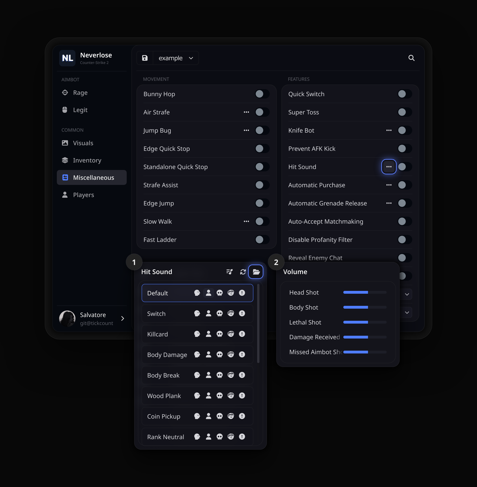
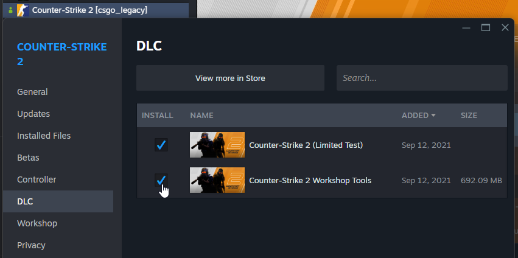
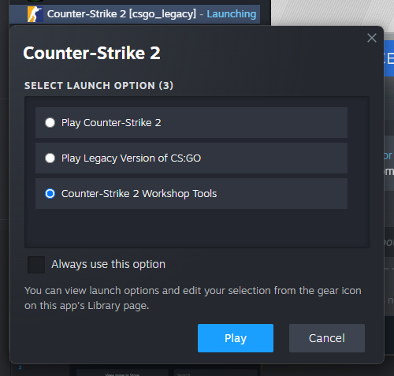
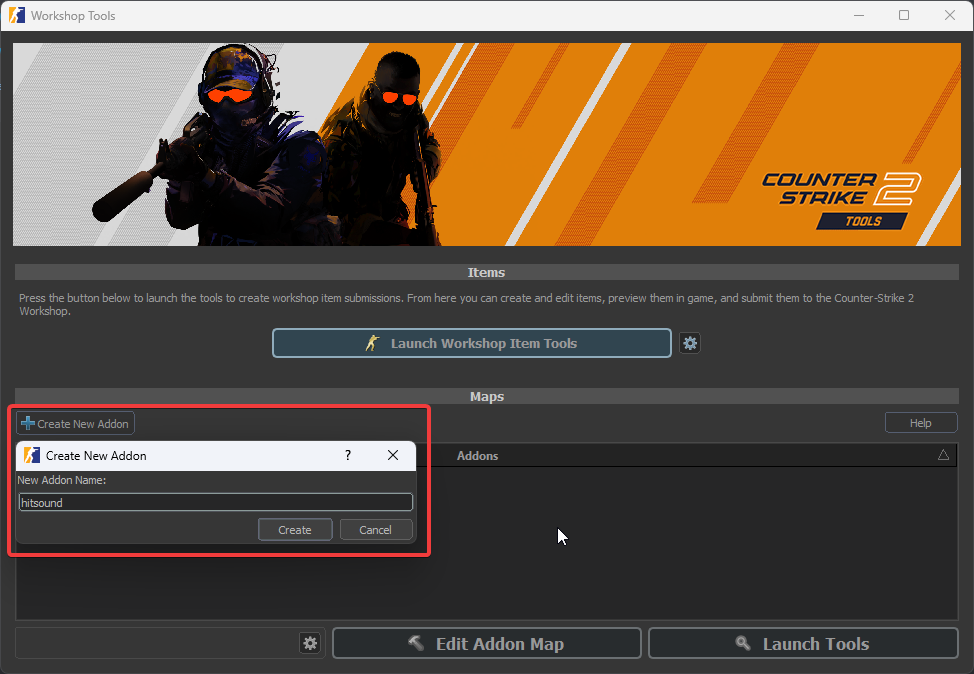
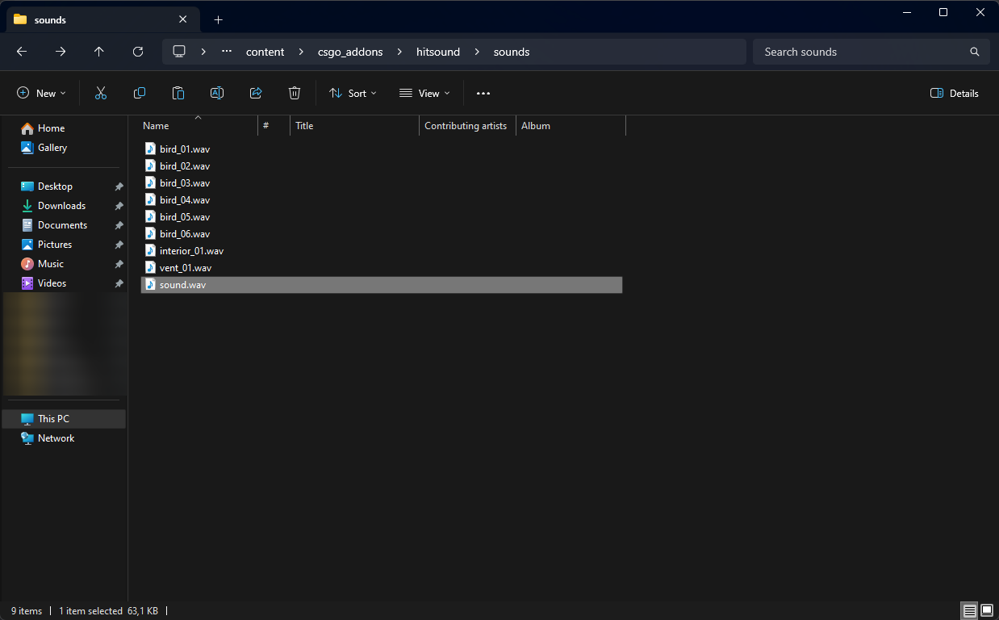
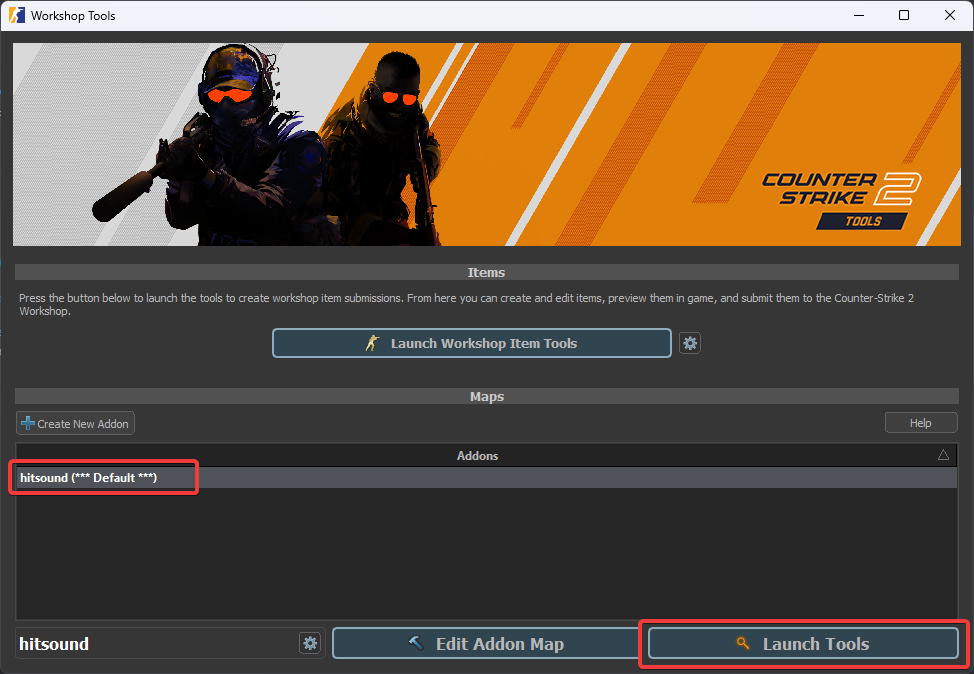
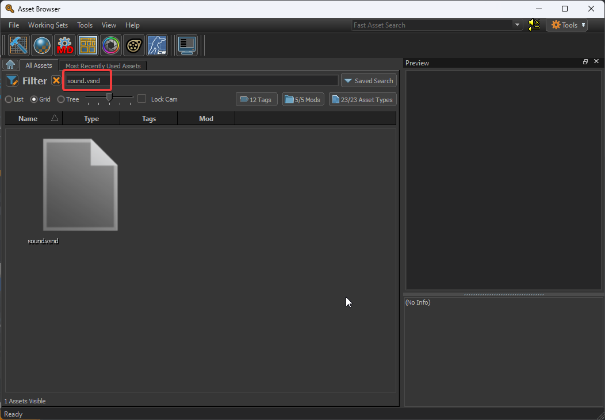
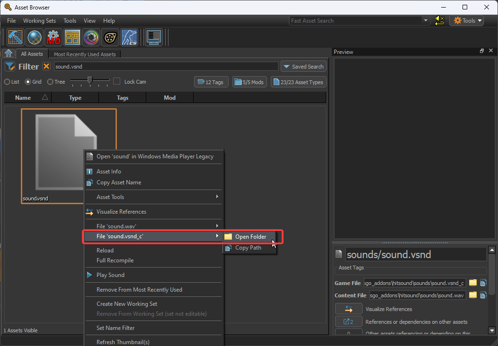

<div align="center">

<h1>Hitsounds</h1>

**Hit sounds for Neverlose in Counter-Strike 2.**

<a href="https://github.com/tickcount/hitsounds/releases/latest"><picture><source media="(prefers-color-scheme: dark)" srcset="https://shieldcn.dev/github/release/tickcount/hitsounds.svg?variant=secondary&font=geist&mode=dark"></picture></a>
<a href="https://github.com/tickcount/hitsounds/actions/workflows/ci.yml"><picture><source media="(prefers-color-scheme: dark)" srcset="https://shieldcn.dev/github/ci/tickcount/hitsounds.svg?variant=secondary&font=geist&mode=dark"></picture></a>
<a href="https://github.com/tickcount/hitsounds/releases"><picture><source media="(prefers-color-scheme: dark)" srcset="https://shieldcn.dev/github/downloads/tickcount/hitsounds.svg?variant=secondary&font=geist&mode=dark"></picture></a>
<br>
<a href="#-sounds"><picture><source media="(prefers-color-scheme: dark)" srcset="https://shieldcn.dev/badge/sounds-48.svg?variant=secondary&font=geist&logo=lu:AudioLines&mode=dark"></picture></a>
<a href="https://www.counter-strike.net/"><picture><source media="(prefers-color-scheme: dark)" srcset="https://shieldcn.dev/badge/Counter--Strike-2.svg?variant=secondary&font=geist&logo=counterstrike&mode=dark"></picture></a>
<a href="https://neverlose.cc/"><picture><source media="(prefers-color-scheme: dark)" srcset="https://shieldcn.dev/badge/made%20for-Neverlose.svg?variant=secondary&font=geist&logo=lu:Crosshair&mode=dark"></picture></a>

[**Download**](https://github.com/tickcount/hitsounds/releases/latest/download/hitsounds.zip) &nbsp;·&nbsp; [Quick start](#-quick-start) &nbsp;·&nbsp; [Sounds](#-sounds) &nbsp;·&nbsp; [Your own sound](#-your-own-sound) &nbsp;·&nbsp; [FAQ](#-faq) &nbsp;·&nbsp; [Contributing](#-contributing)

**English** &nbsp;·&nbsp; [Русский](README_ru.md) &nbsp;·&nbsp; [简体中文](README_zh.md)

</div>

<br>

A collection of **ready-to-use hit sounds** for Neverlose in Counter-Strike 2.
Download **one archive**, drop the sounds into the folder Neverlose opens for
you, and pick one for **head shots, body shots, kills, damage you take and
missed shots**. Every change to the collection is checked and **released
automatically**.

<p align="center">
  
  <br>
  <sub><b>Miscellaneous › Hit Sound</b>: the list of sounds, with the folder button that opens the sounds folder,
  and the volume of each event.</sub>
</p>

## 🚀 Quick start

1. **Download** [`hitsounds.zip`](https://github.com/tickcount/hitsounds/releases/latest/download/hitsounds.zip)
   from the latest release.
2. **Open the sounds folder** from Neverlose: <kbd>Common</kbd> ›
   <kbd>Miscellaneous</kbd> › <kbd>Features</kbd> › <kbd>Hit Sound</kbd> <kbd>•••</kbd>,
   then the **folder button** in the popup's header.
3. **Copy the sounds** from the archive into that folder: the `.vsnd_c` files
   themselves, not a folder with them.
4. **Press Refresh** (the arrows next to the folder button). The sounds join the
   list: the icons on a row assign it to a **head shot**, **body shot**,
   **lethal shot**, **damage received** or **missed aimbot shot**.

> [!TIP]
> The first button in the popup's header sets the **volume** of each of those
> events.

## 🎧 Sounds

Each name is what you see in Neverlose's list. This table updates itself with
every release.

<!-- sounds:begin -->
<table>
  <tr><td><code>agpa1</code></td><td><code>agpa2</code></td><td><code>aimbooster</code></td><td><code>amongus_kill</code></td></tr>
  <tr><td><code>applepay</code></td><td><code>arena_switch</code></td><td><code>bameware</code></td><td><code>bell</code></td></tr>
  <tr><td><code>ben</code></td><td><code>bonk</code></td><td><code>brotato</code></td><td><code>bubble</code></td></tr>
  <tr><td><code>click</code></td><td><code>cod</code></td><td><code>combobreak</code></td><td><code>door</code></td></tr>
  <tr><td><code>fatality</code></td><td><code>flush</code></td><td><code>grenade_jumpthrow</code></td><td><code>hentai1</code></td></tr>
  <tr><td><code>hentai2</code></td><td><code>hentai3</code></td><td><code>kick</code></td><td><code>kill_doof_01</code></td></tr>
  <tr><td><code>killcard_1</code></td><td><code>minecraft_bow_ding</code></td><td><code>minecraft_button</code></td><td><code>minecraft_egg_throw</code></td></tr>
  <tr><td><code>minecraft_hit</code></td><td><code>minecraft_xp_gain</code></td><td><code>money_claim</code></td><td><code>mouthsound</code></td></tr>
  <tr><td><code>msfrs</code></td><td><code>na naxuy</code></td><td><code>pop</code></td><td><code>pubg_pan</code></td></tr>
  <tr><td><code>quaver</code></td><td><code>regulus</code></td><td><code>rust_headshot</code></td><td><code>satisfying click</code></td></tr>
  <tr><td><code>spiral knight</code></td><td><code>stony</code></td><td><code>tavern_misc1c</code></td><td><code>telegram_notification</code></td></tr>
  <tr><td><code>trident_pierce</code></td><td><code>water_drop</code></td><td><code>xp_rankdown_02</code></td><td><code>zelda</code></td></tr>
</table>
<!-- sounds:end -->

## 🔨 Your own sound

Any `.wav` can become a hit sound. The game only plays **compiled** sounds
(`.vsnd_c`), and Valve's free Workshop Tools make one in a few clicks:

1. **Install Workshop Tools.** Steam › right-click **Counter-Strike 2** ›
   <kbd>Properties</kbd> › <kbd>DLC</kbd>, tick **Counter-Strike 2 Workshop Tools**.
2. **Launch them.** <kbd>Play</kbd> on Counter-Strike 2 and choose
   **Counter-Strike 2 Workshop Tools**.
3. **Create an addon.** <kbd>Create New Addon</kbd>, name it, for example, `hitsound`.
4. **Add the sound.** Put your `.wav` into the addon's content folder. Name it
   the way it should appear in the menu:

   ```
   Steam\steamapps\common\Counter-Strike Global Offensive\content\csgo_addons\hitsound\sounds
   ```

5. **Open the tools.** Select the addon and press <kbd>Launch Tools</kbd>: the
   Asset Browser opens and compiles the sound.
6. **Find the compiled file.** Search for your sound's name, right-click it ›
   <kbd>File 'name.vsnd_c'</kbd> › <kbd>Open Folder</kbd>. Close Workshop Tools.
7. **Copy the `.vsnd_c`** into the folder from Neverlose's folder button, as in
   the [Quick start](#-quick-start), and press Refresh.

<table>
  <tr>
    <td width="50%" valign="top"><p align="center"><sub><b>1</b> · Workshop Tools in the game's DLC</sub></p></td>
    <td width="50%" valign="top"><p align="center"><sub><b>2</b> · Launch Counter-Strike 2 Workshop Tools</sub></p></td>
  </tr>
  <tr>
    <td valign="top"><p align="center"><sub><b>3</b> · A new addon</sub></p></td>
    <td valign="top"><p align="center"><sub><b>4</b> · The <code>.wav</code> in <code>content\csgo_addons\…\sounds</code></sub></p></td>
  </tr>
  <tr>
    <td valign="top"><p align="center"><sub><b>5</b> · <kbd>Launch Tools</kbd> on the addon</sub></p></td>
    <td valign="top"><p align="center"><sub><b>6</b> · Search for the sound in the Asset Browser</sub></p></td>
  </tr>
  <tr>
    <td valign="top"><p align="center"><sub><b>6</b> · <kbd>Open Folder</kbd> on the <code>.vsnd_c</code></sub></p></td>
    <td valign="top"></td>
  </tr>
</table>

> [!TIP]
> Short, punchy sounds work best: a hit sound plays many times a round. Trim
> the silence at the start, or the sound will lag behind the hit.

## ❓ FAQ

<details>
<summary><b>The sounds are not in Neverlose's list</b></summary>

<br>

Press Refresh in the popup's header first. If they are still missing, open the
folder with the folder button and check that the `.vsnd_c` files lie right in
it: Windows' <kbd>Extract All</kbd> puts them in a `hitsounds` folder of their
own, so copy them out of it.

</details>

<details>
<summary><b>Can I drop a .wav or .mp3 in the folder?</b></summary>

<br>

No: the game plays only compiled `.vsnd_c` sounds. Compile it with
Workshop Tools as in [Your own sound](#-your-own-sound); it takes a minute.

</details>

<details>
<summary><b>How do I update the collection?</b></summary>

<br>

Download the latest `hitsounds.zip` and copy its sounds over the old ones.
Sounds removed from the collection stay in your folder until you delete them.

</details>

<details>
<summary><b>How do I remove the sounds?</b></summary>

<br>

Open the folder with the folder button and delete the ones you no longer want,
then press Refresh.

</details>

## 🤝 Contributing

Have a sound worth sharing? Open a pull request:

1. **Compile it** as in [Your own sound](#-your-own-sound) and name it the way
   it should appear in the menu.
2. **Add it to `hitsounds/`**: on GitHub, open the folder, then
   <kbd>Add file</kbd> › <kbd>Upload files</kbd>.
3. **Open the pull request.** CI checks the file; once it is merged, the sound
   is in the next release. There is no need to touch the README: the sound
   list updates itself.

## 🧰 Development

```
hitsounds/                     the sounds, one .vsnd_c each
scripts/hitsounds.py           check, README sound list, archive and release notes (Python 3, no dependencies)
docs/                          the logo, the menu screenshot and the guide's screenshots
.github/workflows/ci.yml       checks and releases
```

```sh
python3 scripts/hitsounds.py check            # validate every file in hitsounds/
python3 scripts/hitsounds.py readme           # refresh the sound list in the READMEs
python3 scripts/hitsounds.py build            # dist/hitsounds.zip and dist/sha256sums.txt
python3 scripts/hitsounds.py notes --base v…  # release notes against an earlier release
```

The archive is reproducible: the same sounds always give the same
`hitsounds.zip`, byte for byte. A release can also be started by hand from
<kbd>Actions</kbd> › <kbd>CI</kbd> › <kbd>Run workflow</kbd>.

## 🙏 Acknowledgments

- [v1pix/neverlose-custom-hitsounds](https://github.com/v1pix/neverlose-custom-hitsounds), the guide to compiling sounds and its screenshots
- [LazyMind](https://github.com/LazyMind) and [bespredel1337](https://github.com/bespredel1337), who added sounds to the collection
- Valve, for Counter-Strike 2 Workshop Tools

The sounds belong to their original authors.

---

<div align="center">
<sub>Made for Counter-Strike 2 · <a href="https://github.com/tickcount/hitsounds/releases/latest">Latest release</a> · <a href="#readme">Back to top ↑</a></sub>
</div>
