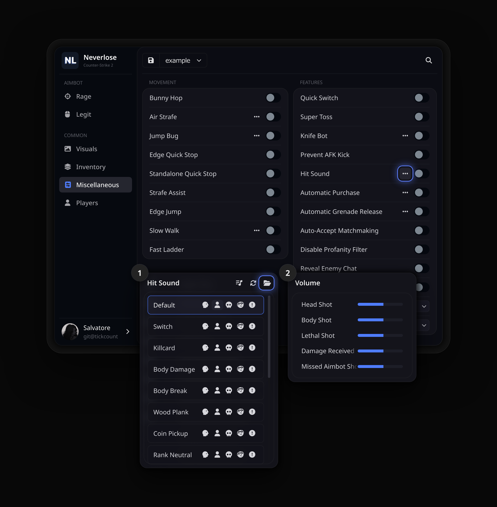
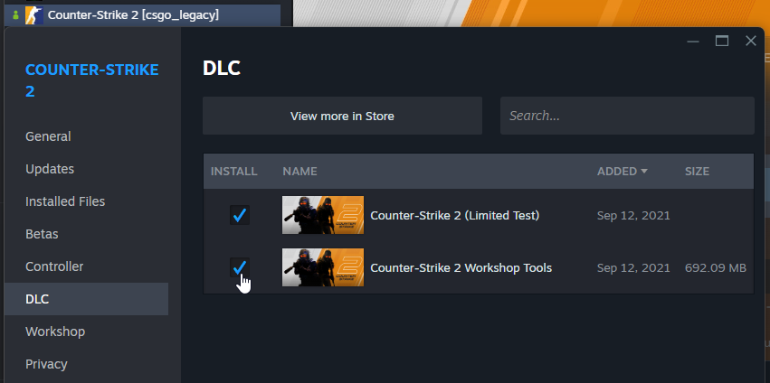
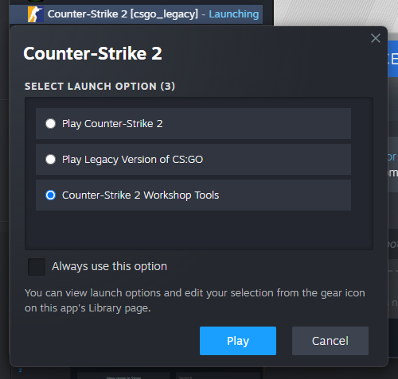
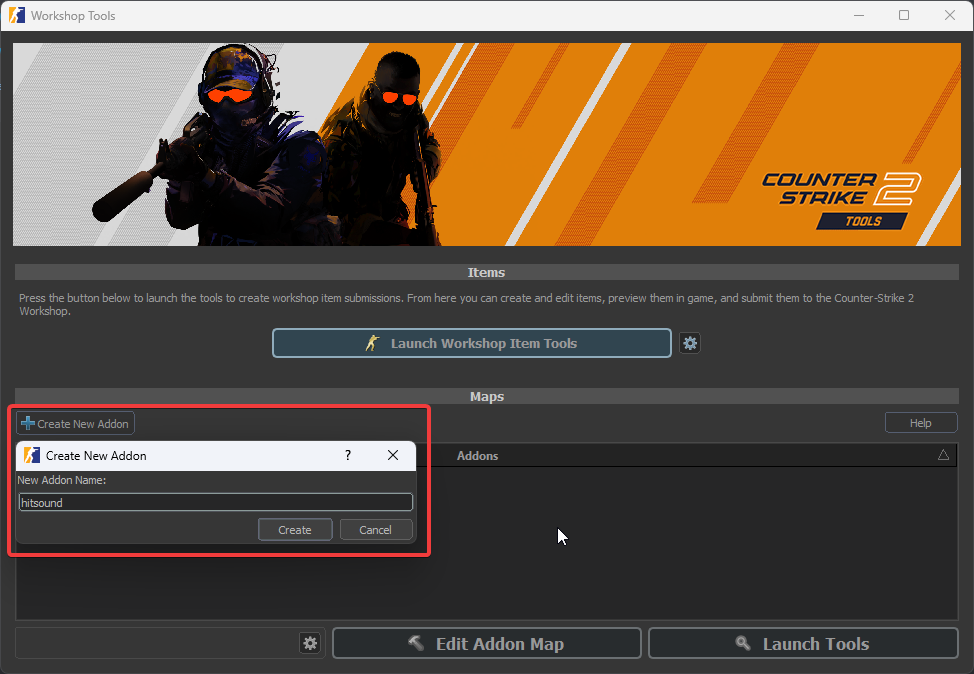
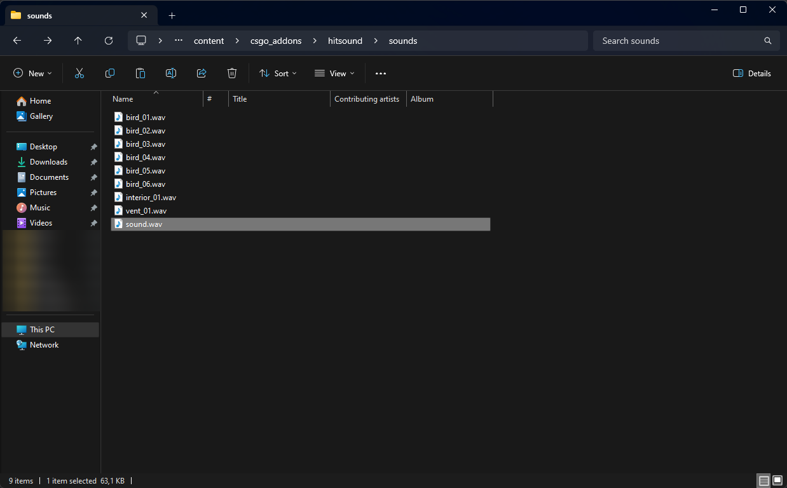
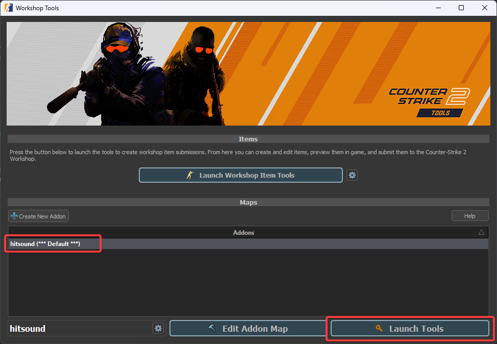
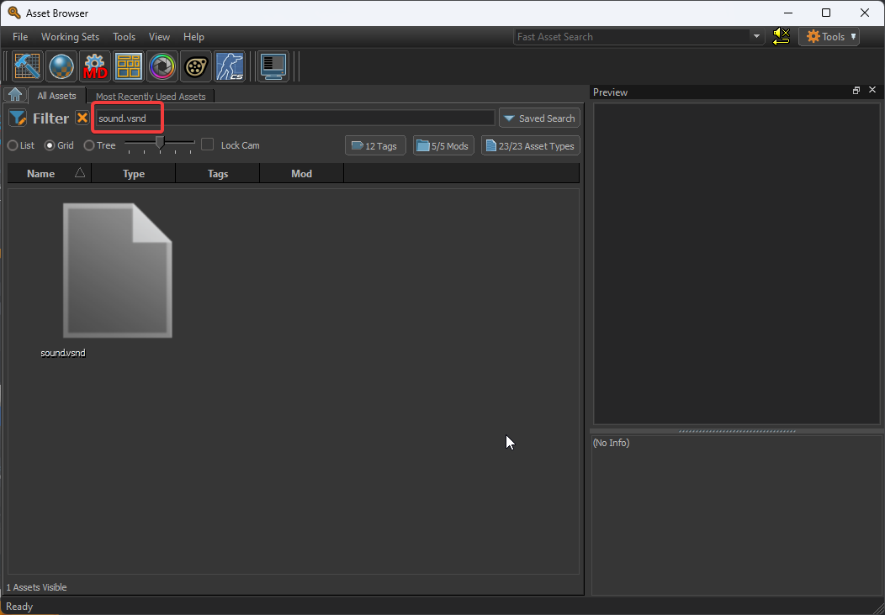
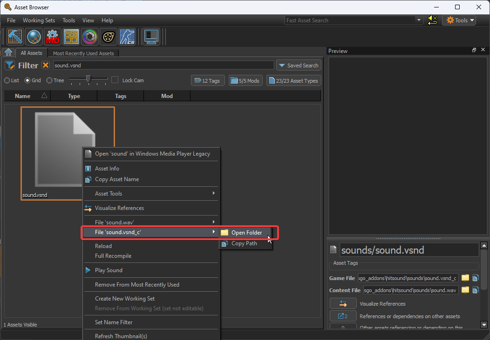

<div align="center">

<h1>Hitsounds</h1>

**Хитсаунды для Neverlose в Counter-Strike 2.**

<a href="https://github.com/tickcount/hitsounds/releases/latest"><picture><source media="(prefers-color-scheme: dark)" srcset="https://shieldcn.dev/github/release/tickcount/hitsounds.svg?variant=secondary&font=geist&mode=dark"></picture></a>
<a href="https://github.com/tickcount/hitsounds/actions/workflows/ci.yml"><picture><source media="(prefers-color-scheme: dark)" srcset="https://shieldcn.dev/github/ci/tickcount/hitsounds.svg?variant=secondary&font=geist&mode=dark"></picture></a>
<a href="https://github.com/tickcount/hitsounds/releases"><picture><source media="(prefers-color-scheme: dark)" srcset="https://shieldcn.dev/github/downloads/tickcount/hitsounds.svg?variant=secondary&font=geist&mode=dark"></picture></a>
<br>
<a href="#-звуки"><picture><source media="(prefers-color-scheme: dark)" srcset="https://shieldcn.dev/badge/sounds-48.svg?variant=secondary&font=geist&logo=lu:AudioLines&mode=dark"></picture></a>
<a href="https://www.counter-strike.net/"><picture><source media="(prefers-color-scheme: dark)" srcset="https://shieldcn.dev/badge/Counter--Strike-2.svg?variant=secondary&font=geist&logo=counterstrike&mode=dark"></picture></a>
<a href="https://neverlose.cc/"><picture><source media="(prefers-color-scheme: dark)" srcset="https://shieldcn.dev/badge/made%20for-Neverlose.svg?variant=secondary&font=geist&logo=lu:Crosshair&mode=dark"></picture></a>

[**Скачать**](https://github.com/tickcount/hitsounds/releases/latest/download/hitsounds.zip) &nbsp;·&nbsp; [Быстрый старт](#-быстрый-старт) &nbsp;·&nbsp; [Звуки](#-звуки) &nbsp;·&nbsp; [Свой звук](#-свой-звук) &nbsp;·&nbsp; [Вопросы](#-вопросы-и-ответы) &nbsp;·&nbsp; [Как добавить звук](#-как-добавить-звук)

[English](README.md) &nbsp;·&nbsp; **Русский** &nbsp;·&nbsp; [简体中文](README_zh.md)

</div>

<br>

Коллекция **готовых хитсаундов** для Neverlose в Counter-Strike 2. Скачайте
**один архив**, скиньте звуки в папку, которую откроет сам Neverlose, и
выберите звук для **попаданий в голову, в тело, убийств, полученного урона и
промахов**. Каждое изменение коллекции проверяется и **выходит в релиз
автоматически**.

<p align="center">
  
  <br>
  <sub><b>Miscellaneous › Hit Sound</b>: список звуков с кнопкой папки, которая открывает папку со звуками,
  и громкость для каждого события.</sub>
</p>

## 🚀 Быстрый старт

1. **Скачайте** [`hitsounds.zip`](https://github.com/tickcount/hitsounds/releases/latest/download/hitsounds.zip)
   из последнего релиза.
2. **Откройте папку со звуками** из Neverlose: <kbd>Common</kbd> ›
   <kbd>Miscellaneous</kbd> › <kbd>Features</kbd> › <kbd>Hit Sound</kbd> <kbd>•••</kbd>,
   затем **иконка папки** в шапке попапа.
3. **Скопируйте звуки** из архива в эту папку: сами файлы `.vsnd_c`, а не папку
   с ними.
4. **Нажмите «Обновить»** (стрелки рядом с иконкой папки). Звуки появятся в
   списке: иконки в строке назначают звук на **попадание в голову**, **в тело**,
   **убийство**, **полученный урон** или **промах аимбота**.

> [!TIP]
> Первая кнопка в шапке попапа задаёт **громкость** для каждого из этих
> событий.

## 🎧 Звуки

Название — то, что вы увидите в списке Neverlose. Таблица обновляется сама
с каждым релизом.

<!-- sounds:begin -->
<table>
  <tr><td><code>agpa1</code></td><td><code>agpa2</code></td><td><code>aimbooster</code></td><td><code>amongus_kill</code></td></tr>
  <tr><td><code>applepay</code></td><td><code>arena_switch</code></td><td><code>bameware</code></td><td><code>bell</code></td></tr>
  <tr><td><code>ben</code></td><td><code>bonk</code></td><td><code>brotato</code></td><td><code>bubble</code></td></tr>
  <tr><td><code>click</code></td><td><code>cod</code></td><td><code>combobreak</code></td><td><code>door</code></td></tr>
  <tr><td><code>fatality</code></td><td><code>flush</code></td><td><code>grenade_jumpthrow</code></td><td><code>hentai1</code></td></tr>
  <tr><td><code>hentai2</code></td><td><code>hentai3</code></td><td><code>kick</code></td><td><code>kill_doof_01</code></td></tr>
  <tr><td><code>killcard_1</code></td><td><code>minecraft_bow_ding</code></td><td><code>minecraft_button</code></td><td><code>minecraft_egg_throw</code></td></tr>
  <tr><td><code>minecraft_hit</code></td><td><code>minecraft_xp_gain</code></td><td><code>money_claim</code></td><td><code>mouthsound</code></td></tr>
  <tr><td><code>msfrs</code></td><td><code>na naxuy</code></td><td><code>pop</code></td><td><code>pubg_pan</code></td></tr>
  <tr><td><code>quaver</code></td><td><code>regulus</code></td><td><code>rust_headshot</code></td><td><code>satisfying click</code></td></tr>
  <tr><td><code>spiral knight</code></td><td><code>stony</code></td><td><code>tavern_misc1c</code></td><td><code>telegram_notification</code></td></tr>
  <tr><td><code>trident_pierce</code></td><td><code>water_drop</code></td><td><code>xp_rankdown_02</code></td><td><code>zelda</code></td></tr>
</table>
<!-- sounds:end -->

## 🔨 Свой звук

Хитсаундом может стать любой `.wav`. Игра воспроизводит только
**скомпилированные** звуки (`.vsnd_c`), а бесплатные Workshop Tools от Valve
делают такой за пару кликов:

1. **Установите Workshop Tools.** Steam › правой кнопкой по **Counter-Strike 2** ›
   <kbd>Свойства</kbd> › <kbd>DLC</kbd>, отметьте **Counter-Strike 2 Workshop Tools**.
2. **Запустите их.** <kbd>Играть</kbd> в Counter-Strike 2 и выберите
   **Counter-Strike 2 Workshop Tools**.
3. **Создайте аддон.** <kbd>Create New Addon</kbd>, назовите, например, `hitsound`.
4. **Добавьте звук.** Положите `.wav` в папку контента аддона. Назовите файл так,
   как он должен называться в меню:

   ```
   Steam\steamapps\common\Counter-Strike Global Offensive\content\csgo_addons\hitsound\sounds
   ```

5. **Откройте инструменты.** Выберите аддон и нажмите <kbd>Launch Tools</kbd>:
   откроется Asset Browser, и он скомпилирует звук.
6. **Найдите готовый файл.** Введите название звука в поиск, правой кнопкой ›
   <kbd>File 'название.vsnd_c'</kbd> › <kbd>Open Folder</kbd>. Закройте Workshop Tools.
7. **Скопируйте `.vsnd_c`** в папку, которую открывает иконка папки в Neverlose,
   как в [быстром старте](#-быстрый-старт), и нажмите «Обновить».

<table>
  <tr>
    <td width="50%" valign="top"><p align="center"><sub><b>1</b> · Workshop Tools в DLC игры</sub></p></td>
    <td width="50%" valign="top"><p align="center"><sub><b>2</b> · Запуск Counter-Strike 2 Workshop Tools</sub></p></td>
  </tr>
  <tr>
    <td valign="top"><p align="center"><sub><b>3</b> · Новый аддон</sub></p></td>
    <td valign="top"><p align="center"><sub><b>4</b> · <code>.wav</code> в <code>content\csgo_addons\…\sounds</code></sub></p></td>
  </tr>
  <tr>
    <td valign="top"><p align="center"><sub><b>5</b> · <kbd>Launch Tools</kbd> на аддоне</sub></p></td>
    <td valign="top"><p align="center"><sub><b>6</b> · Поиск звука в Asset Browser</sub></p></td>
  </tr>
  <tr>
    <td valign="top"><p align="center"><sub><b>6</b> · <kbd>Open Folder</kbd> у <code>.vsnd_c</code></sub></p></td>
    <td valign="top"></td>
  </tr>
</table>

> [!TIP]
> Лучше всего работают короткие, чёткие звуки: хитсаунд звучит много раз за
> раунд. Обрежьте тишину в начале, иначе звук будет запаздывать за попаданием.

## ❓ Вопросы и ответы

<details>
<summary><b>Звуков нет в списке Neverlose</b></summary>

<br>

Сначала нажмите «Обновить» в шапке попапа. Если их всё ещё нет, откройте папку
иконкой папки и проверьте, что файлы `.vsnd_c` лежат прямо в ней: «Извлечь всё»
в Windows кладёт их в отдельную папку `hitsounds`, так что скопируйте их оттуда.

</details>

<details>
<summary><b>Можно просто положить .wav или .mp3 в папку?</b></summary>

<br>

Нет: игра воспроизводит только скомпилированные `.vsnd_c`. Скомпилируйте звук
в Workshop Tools, как в разделе [Свой звук](#-свой-звук), это займёт минуту.

</details>

<details>
<summary><b>Как обновить коллекцию?</b></summary>

<br>

Скачайте свежий `hitsounds.zip` и скопируйте звуки поверх старых. Звуки,
которые убрали из коллекции, останутся в вашей папке, пока вы их не удалите.

</details>

<details>
<summary><b>Как удалить звуки?</b></summary>

<br>

Откройте папку иконкой папки, удалите ненужные звуки и нажмите «Обновить».

</details>

## 🤝 Как добавить звук

Есть звук, которым хочется поделиться? Откройте pull request:

1. **Скомпилируйте его**, как в разделе [Свой звук](#-свой-звук), и назовите так,
   как он должен называться в меню.
2. **Добавьте его в `hitsounds/`**: на GitHub откройте папку, затем
   <kbd>Add file</kbd> › <kbd>Upload files</kbd>.
3. **Откройте pull request.** CI проверит файл; после слияния звук попадёт
   в следующий релиз. README трогать не нужно: список звуков обновится сам.

## 🧰 Разработка

```
hitsounds/                     звуки, по одному .vsnd_c
scripts/hitsounds.py           проверка, список звуков в README, архив и описание релиза (Python 3, без зависимостей)
docs/                          логотип, скриншот меню и скриншоты гайда
.github/workflows/ci.yml       проверки и релизы
```

```sh
python3 scripts/hitsounds.py check            # проверить каждый файл в hitsounds/
python3 scripts/hitsounds.py readme           # обновить список звуков в README
python3 scripts/hitsounds.py build            # dist/hitsounds.zip и dist/sha256sums.txt
python3 scripts/hitsounds.py notes --base v…  # описание релиза относительно прошлого
```

Архив воспроизводимый: одни и те же звуки всегда дают байт в байт один и тот же
`hitsounds.zip`. Релиз можно запустить и вручную: <kbd>Actions</kbd> ›
<kbd>CI</kbd> › <kbd>Run workflow</kbd>.

## 🙏 Благодарности

- [v1pix/neverlose-custom-hitsounds](https://github.com/v1pix/neverlose-custom-hitsounds) — гайд по компиляции звуков и его скриншоты
- [LazyMind](https://github.com/LazyMind) и [bespredel1337](https://github.com/bespredel1337) — за звуки в коллекции
- Valve — за Counter-Strike 2 Workshop Tools

Звуки принадлежат их авторам.

---

<div align="center">
<sub>Сделано для Counter-Strike 2 · <a href="https://github.com/tickcount/hitsounds/releases/latest">Последний релиз</a> · <a href="#readme">Наверх ↑</a></sub>
</div>
