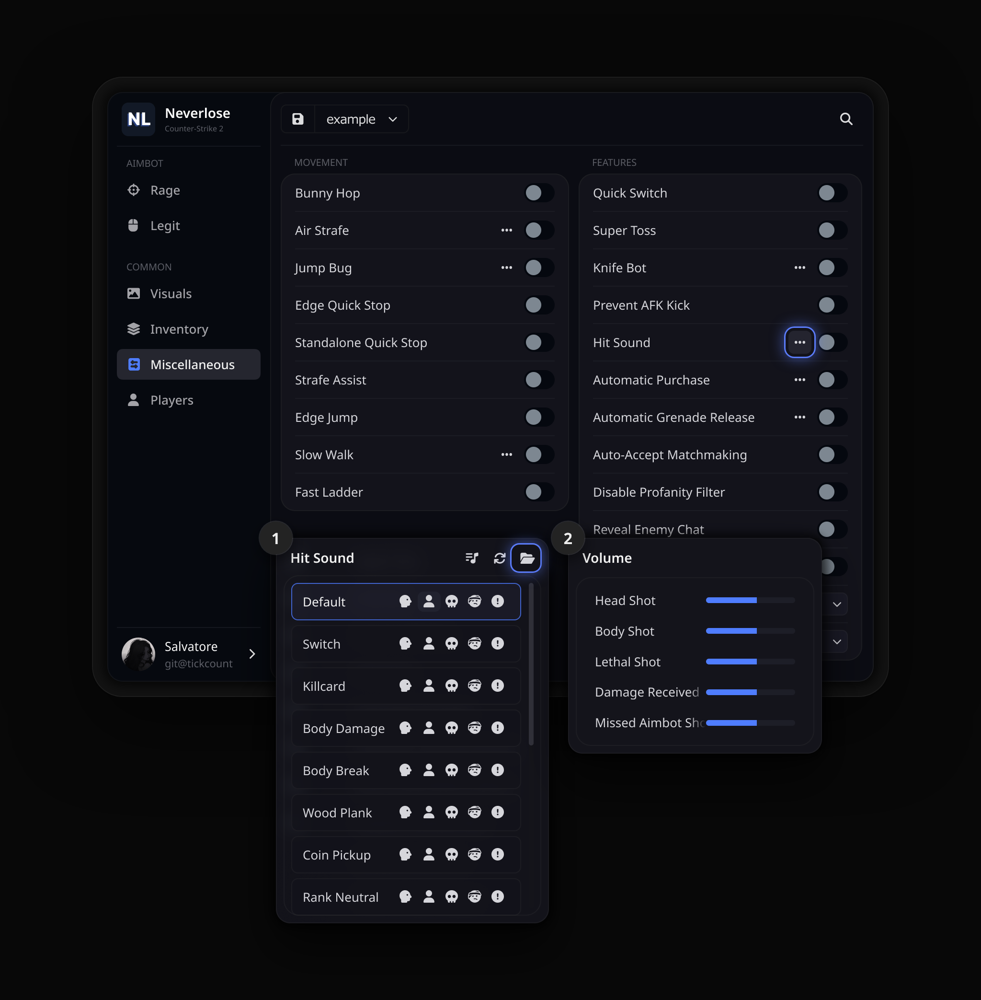
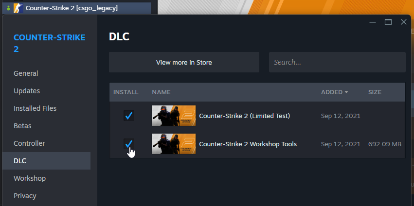
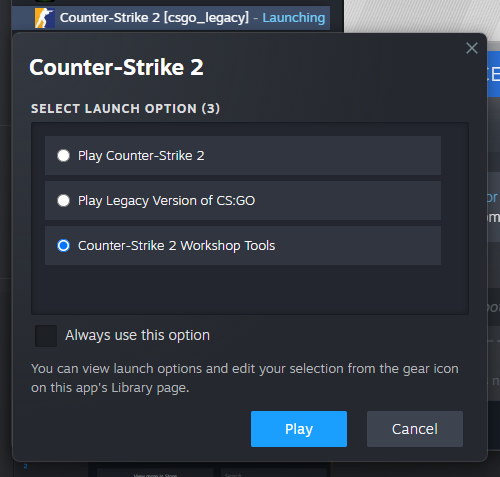
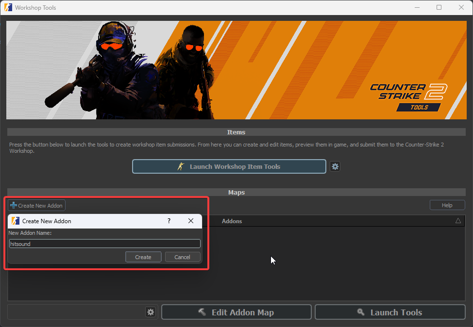
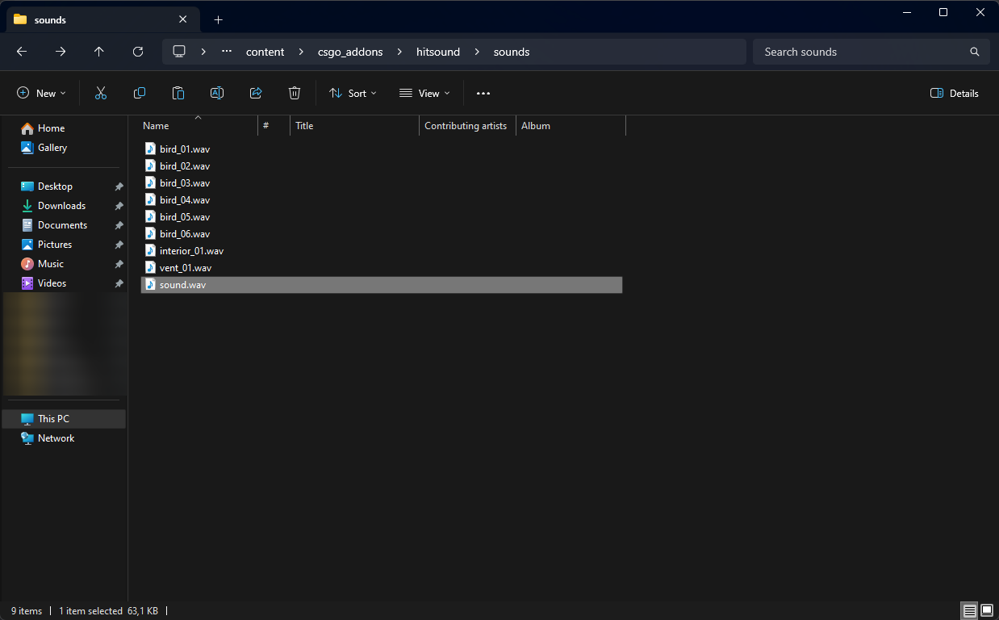
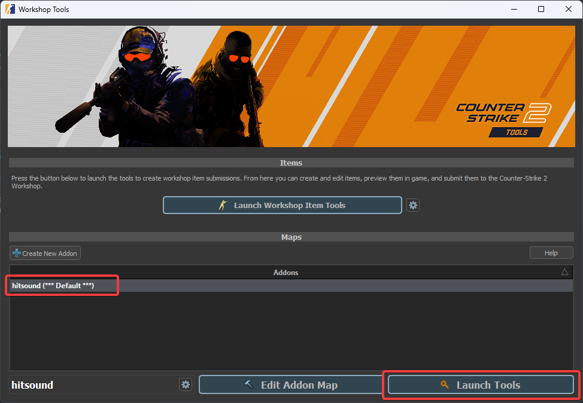
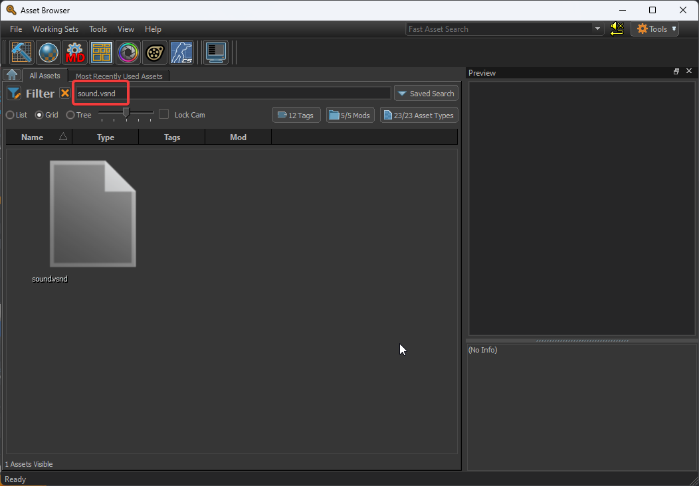
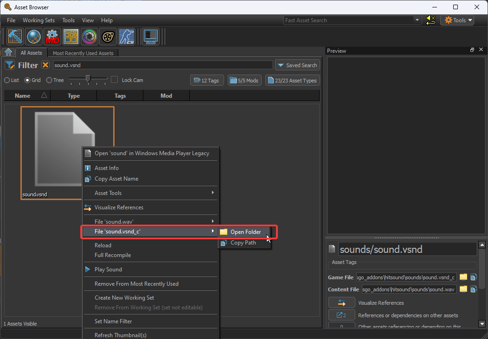

<div align="center">

<h1>Hitsounds</h1>

**适用于 Counter-Strike 2 中 Neverlose 的命中音效。**

<a href="https://github.com/tickcount/hitsounds/releases/latest"><picture><source media="(prefers-color-scheme: dark)" srcset="https://shieldcn.dev/github/release/tickcount/hitsounds.svg?variant=secondary&font=geist&mode=dark"></picture></a>
<a href="https://github.com/tickcount/hitsounds/actions/workflows/ci.yml"><picture><source media="(prefers-color-scheme: dark)" srcset="https://shieldcn.dev/github/ci/tickcount/hitsounds.svg?variant=secondary&font=geist&mode=dark"></picture></a>
<a href="https://github.com/tickcount/hitsounds/releases"><picture><source media="(prefers-color-scheme: dark)" srcset="https://shieldcn.dev/github/downloads/tickcount/hitsounds.svg?variant=secondary&font=geist&mode=dark"></picture></a>
<br>
<a href="#-音效列表"><picture><source media="(prefers-color-scheme: dark)" srcset="https://shieldcn.dev/badge/sounds-48.svg?variant=secondary&font=geist&logo=lu:AudioLines&mode=dark"></picture></a>
<a href="https://www.counter-strike.net/"><picture><source media="(prefers-color-scheme: dark)" srcset="https://shieldcn.dev/badge/Counter--Strike-2.svg?variant=secondary&font=geist&logo=counterstrike&mode=dark"></picture></a>
<a href="https://neverlose.cc/"><picture><source media="(prefers-color-scheme: dark)" srcset="https://shieldcn.dev/badge/made%20for-Neverlose.svg?variant=secondary&font=geist&logo=lu:Crosshair&mode=dark"></picture></a>

[**下载**](https://github.com/tickcount/hitsounds/releases/latest/download/hitsounds.zip) &nbsp;·&nbsp; [快速开始](#-快速开始) &nbsp;·&nbsp; [音效列表](#-音效列表) &nbsp;·&nbsp; [自制音效](#-自制音效) &nbsp;·&nbsp; [常见问题](#-常见问题) &nbsp;·&nbsp; [贡献音效](#-贡献音效)

[English](README.md) &nbsp;·&nbsp; [Русский](README_ru.md) &nbsp;·&nbsp; **简体中文**

</div>

<br>

一套为 Counter-Strike 2 中的 Neverlose 准备的**即用型命中音效**。只需下载
**一个压缩包**，把音效放进 Neverlose 为你打开的文件夹，就能为**爆头、身体命中、
击杀、受到伤害和未命中**分别挑选音效。音效库的每次改动都会经过检查并**自动发布**。

<p align="center">
  
  <br>
  <sub><b>Miscellaneous › Hit Sound</b>：音效列表，文件夹按钮可打开音效文件夹；以及每种事件的音量。</sub>
</p>

## 🚀 快速开始

1. 从最新版本**下载** [`hitsounds.zip`](https://github.com/tickcount/hitsounds/releases/latest/download/hitsounds.zip)。
2. 在 Neverlose 中**打开音效文件夹**：<kbd>Common</kbd> › <kbd>Miscellaneous</kbd> ›
   <kbd>Features</kbd> › <kbd>Hit Sound</kbd> <kbd>•••</kbd>，然后点击弹窗标题栏中的**文件夹按钮**。
3. 把压缩包里的音效**复制**到该文件夹：直接复制 `.vsnd_c` 文件本身，而不是包含它们的文件夹。
4. **点击刷新**（文件夹按钮旁边的箭头）。音效会出现在列表中：每行的图标用于把该音效分配给
   **爆头**、**身体命中**、**致命一击**、**受到伤害**或**自瞄未命中**。

> [!TIP]
> 弹窗标题栏中的第一个按钮用于分别设置上述每种事件的**音量**。

## 🎧 音效列表

名称即你在 Neverlose 列表中看到的名字。此表会随每次发布自动更新。

<!-- sounds:begin -->
<table>
  <tr><td><code>agpa1</code></td><td><code>agpa2</code></td><td><code>aimbooster</code></td><td><code>amongus_kill</code></td></tr>
  <tr><td><code>applepay</code></td><td><code>arena_switch</code></td><td><code>bameware</code></td><td><code>bell</code></td></tr>
  <tr><td><code>ben</code></td><td><code>bonk</code></td><td><code>brotato</code></td><td><code>bubble</code></td></tr>
  <tr><td><code>click</code></td><td><code>cod</code></td><td><code>combobreak</code></td><td><code>door</code></td></tr>
  <tr><td><code>fatality</code></td><td><code>flush</code></td><td><code>grenade_jumpthrow</code></td><td><code>hentai1</code></td></tr>
  <tr><td><code>hentai2</code></td><td><code>hentai3</code></td><td><code>kick</code></td><td><code>kill_doof_01</code></td></tr>
  <tr><td><code>killcard_1</code></td><td><code>minecraft_bow_ding</code></td><td><code>minecraft_button</code></td><td><code>minecraft_egg_throw</code></td></tr>
  <tr><td><code>minecraft_hit</code></td><td><code>minecraft_xp_gain</code></td><td><code>money_claim</code></td><td><code>mouthsound</code></td></tr>
  <tr><td><code>msfrs</code></td><td><code>na naxuy</code></td><td><code>pop</code></td><td><code>pubg_pan</code></td></tr>
  <tr><td><code>quaver</code></td><td><code>regulus</code></td><td><code>rust_headshot</code></td><td><code>satisfying click</code></td></tr>
  <tr><td><code>spiral knight</code></td><td><code>stony</code></td><td><code>tavern_misc1c</code></td><td><code>telegram_notification</code></td></tr>
  <tr><td><code>trident_pierce</code></td><td><code>water_drop</code></td><td><code>xp_rankdown_02</code></td><td><code>zelda</code></td></tr>
</table>
<!-- sounds:end -->

## 🔨 自制音效

任何 `.wav` 都可以做成命中音效。游戏只播放**编译后**的音效（`.vsnd_c`），而 Valve
免费的 Workshop Tools 只需几步就能生成：

1. **安装 Workshop Tools。** Steam › 右键 **Counter-Strike 2** › <kbd>属性</kbd> ›
   <kbd>DLC</kbd>，勾选 **Counter-Strike 2 Workshop Tools**。
2. **启动它。** 在 Counter-Strike 2 上点击 <kbd>开始游戏</kbd>，选择
   **Counter-Strike 2 Workshop Tools**。
3. **创建插件。** <kbd>Create New Addon</kbd>，命名，例如 `hitsound`。
4. **添加音效。** 把 `.wav` 放进插件的内容文件夹，文件名即菜单中显示的名称：

   ```
   Steam\steamapps\common\Counter-Strike Global Offensive\content\csgo_addons\hitsound\sounds
   ```

5. **打开工具。** 选中插件并点击 <kbd>Launch Tools</kbd>：Asset Browser 打开后会编译该音效。
6. **找到编译好的文件。** 搜索音效名称，右键 › <kbd>File '名称.vsnd_c'</kbd> ›
   <kbd>Open Folder</kbd>。然后关闭 Workshop Tools。
7. 按照[快速开始](#-快速开始)，把 **`.vsnd_c` 复制**到 Neverlose 文件夹按钮打开的文件夹中，并点击刷新。

<table>
  <tr>
    <td width="50%" valign="top"><p align="center"><sub><b>1</b> · 游戏 DLC 中的 Workshop Tools</sub></p></td>
    <td width="50%" valign="top"><p align="center"><sub><b>2</b> · 启动 Counter-Strike 2 Workshop Tools</sub></p></td>
  </tr>
  <tr>
    <td valign="top"><p align="center"><sub><b>3</b> · 新建插件</sub></p></td>
    <td valign="top"><p align="center"><sub><b>4</b> · <code>content\csgo_addons\…\sounds</code> 中的 <code>.wav</code></sub></p></td>
  </tr>
  <tr>
    <td valign="top"><p align="center"><sub><b>5</b> · 在插件上点击 <kbd>Launch Tools</kbd></sub></p></td>
    <td valign="top"><p align="center"><sub><b>6</b> · 在 Asset Browser 中搜索音效</sub></p></td>
  </tr>
  <tr>
    <td valign="top"><p align="center"><sub><b>6</b> · 对 <code>.vsnd_c</code> 使用 <kbd>Open Folder</kbd></sub></p></td>
    <td valign="top"></td>
  </tr>
</table>

> [!TIP]
> 短而干脆的音效效果最好：命中音效每回合会播放很多次。请剪掉开头的静音，否则音效会比命中慢半拍。

## ❓ 常见问题

<details>
<summary><b>Neverlose 列表中没有这些音效</b></summary>

<br>

先点击弹窗标题栏中的刷新。如果仍然没有，用文件夹按钮打开文件夹，确认 `.vsnd_c`
文件直接位于其中：Windows 的<kbd>全部解压缩</kbd>会把它们放进单独的 `hitsounds`
文件夹，请把文件从里面复制出来。

</details>

<details>
<summary><b>可以直接把 .wav 或 .mp3 放进文件夹吗？</b></summary>

<br>

不可以：游戏只播放编译后的 `.vsnd_c`。请按照[自制音效](#-自制音效)用 Workshop Tools 编译，只需一分钟。

</details>

<details>
<summary><b>如何更新音效库？</b></summary>

<br>

下载最新的 `hitsounds.zip`，把音效复制并覆盖旧文件。已从音效库中移除的音效会留在你的文件夹里，直到你手动删除。

</details>

<details>
<summary><b>如何删除音效？</b></summary>

<br>

用文件夹按钮打开文件夹，删除不需要的音效，然后点击刷新。

</details>

## 🤝 贡献音效

有值得分享的音效？欢迎提交 pull request：

1. 按照[自制音效](#-自制音效)**编译**，并以菜单中应显示的名称命名。
2. **添加到 `hitsounds/`**：在 GitHub 上打开该文件夹，然后 <kbd>Add file</kbd> › <kbd>Upload files</kbd>。
3. **提交 pull request。** CI 会检查文件；合并后，音效会出现在下一个版本中。无需修改 README：音效列表会自动更新。

## 🧰 开发

```
hitsounds/                     音效，每个一个 .vsnd_c
scripts/hitsounds.py           检查、README 音效列表、压缩包和发布说明（Python 3，无依赖）
docs/                          标志、菜单截图和教程截图
.github/workflows/ci.yml       检查与发布
```

```sh
python3 scripts/hitsounds.py check            # 检查 hitsounds/ 中的每个文件
python3 scripts/hitsounds.py readme           # 更新 README 中的音效列表
python3 scripts/hitsounds.py build            # dist/hitsounds.zip 和 dist/sha256sums.txt
python3 scripts/hitsounds.py notes --base v…  # 相对于上一版本的发布说明
```

压缩包可复现：相同的音效总是生成逐字节相同的 `hitsounds.zip`。也可以在
<kbd>Actions</kbd> › <kbd>CI</kbd> › <kbd>Run workflow</kbd> 中手动发布。

## 🙏 致谢

- [v1pix/neverlose-custom-hitsounds](https://github.com/v1pix/neverlose-custom-hitsounds)：音效编译教程及其截图
- [LazyMind](https://github.com/LazyMind) 和 [bespredel1337](https://github.com/bespredel1337)：为音效库添加了音效
- Valve：Counter-Strike 2 Workshop Tools

音效版权归其原作者所有。

---

<div align="center">
<sub>为 Counter-Strike 2 打造 · <a href="https://github.com/tickcount/hitsounds/releases/latest">最新版本</a> · <a href="#readme">回到顶部 ↑</a></sub>
</div>
